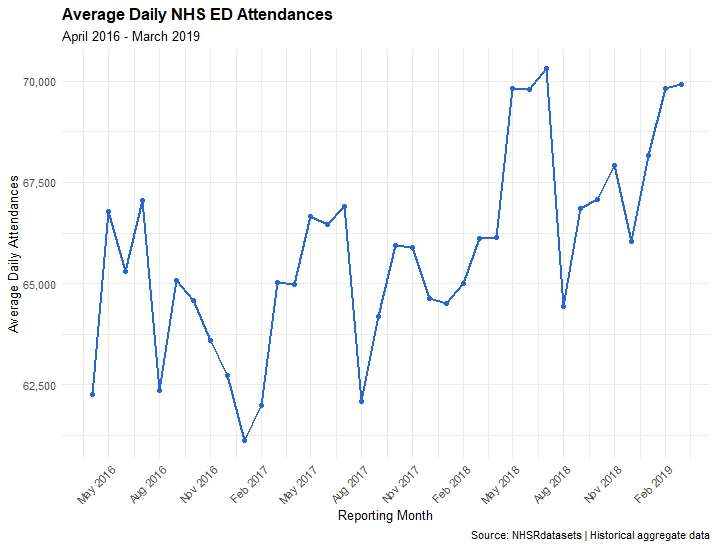

# NHS Emergency Department Utilization & Performance Analytics

**Healthcare Operations Analytics | R | SQL | SQLite | Power BI**

An end-to-end healthcare analytics portfolio project examining historical NHS emergency department (ED) demand, four-hour performance, admissions, and provider reporting across England, April 2016–March 2019.
Executive Dashboard

[View full-size dashboard](https://github.com/abenyarko/NHS-Emergency-Department-Analytics/blob/main/images/NHS%20Emergency%20Department%20Performance.png)

Figure 1. PCC-inspired Power BI executive dashboard showing national ED utilization, performance, and provider comparisons. The image displays the complete historical period with slicers cleared.

The one-page interactive Power BI dashboard turns aggregate NHS activity data into an executive-level operational view. Its light blue-gray background, navy headings, blue and teal chart lines, and restrained gold accents support clear visual hierarchy.

Interactive filters: Year, Month, ED Type (1, 2, other), and NHS Provider.

Key performance indicators: Total ED Attendances; Total Four-Hour Breaches; Four-Hour Breach Rate; Total Admissions; Admission Ratio; and Reporting Providers.

Visual analyses:
- Monthly ED Demand & Four-Hour Breach Rate: Dual-axis line chart comparing average daily attendance with breach rate across 36 months.
- ED Attendances by Department Type: Column chart comparing reported utilization for types 1, 2, and other.
- Top 4 NHS Providers by Average Monthly Attendance: Interactive horizontal bar chart with reporting-coverage eligibility applied; rankings can change with slicer selections.
The dashboard is intended for descriptive exploration and decision support, not real-time NHS monitoring. The historical correlation statistics reported below are not dynamically recalculated by the dashboard slicers.

Power BI deliverable: [Open the Power BI project file](https://github.com/abenyarko/NHS-Emergency-Department-Analytics/blob/main/powerbi/NHS_Emergency_Department_Performance.pbix) 

## Executive Summary

This project examines historical emergency department (ED) utilization and operational performance across National Health Service (NHS) healthcare organizations in England from **April 2016 through March 2019**.

The analysis integrates 12,765 monthly emergency department activity records representing 274 NHS providers. Using R for data preparation and validation, SQLite and SQL for relational data management and analysis, and NHS Organisation Data Service (ODS) reference information for provider enrichment, the project transforms publicly available healthcare data into operational insights.

The analysis focuses on national utilization trends, four-hour performance breaches, admission activity, departmental differences, provider reporting coverage, and the relationship between emergency department demand and performance.

**Project objective:** Demonstrate how healthcare operational data can support performance monitoring, capacity planning, resource allocation, and evidence-informed decision-making.

## Business Questions

1. What were the national volumes of ED attendances, admissions, and four-hour breaches?
2. How did emergency department utilization change between April 2016 and March 2019?
3. How did utilization and performance differ across emergency department types?
4. Was higher monthly ED attendance associated with higher four-hour breach rates?
5. Were there identifiable seasonal patterns in emergency department performance?
6. How did utilization and reporting completeness vary across NHS providers?

## Data Sources

### NHS Emergency Department Activity

- **Source:** `NHSRdatasets` R package
- **Dataset:** `ae_attendances`
- **Study period:** April 2016–March 2019
- **Activity records:** 12,765
- **Distinct providers:** 274
- **Reporting months:** 36

Key variables include reporting period, organization code, emergency department type, attendances, breaches, and admissions.

### NHS Organisation Data Service (ODS)

NHS ODS organization lookups were used to enrich emergency department activity records with available provider reference information, including organization names and selected administrative details.

The project uses aggregate healthcare activity records rather than individual patient-level data.

## Technology Stack

| Technology | Application |
|---|---|
| R | Data preprocessing, integration, validation, statistical analysis, and visualization |
| SQL | Aggregation, performance metrics, utilization analysis, and provider comparisons |
| SQLite | Relational database development and data management |
| NHS ODS API | Healthcare organization reference data integration |
| ggplot2 | Longitudinal utilization visualization |
| Power BI | Executive dashboard development |
| GitHub | Version control, documentation, and portfolio presentation |

## Analytical Methodology

### 1. Data Preparation and Integration

Imported and examined NHS emergency department activity data using R.

The preprocessing workflow included reviewing variable types, missing values, reporting periods, department categories, and organization identifiers.

NHS ODS reference information was joined to emergency department activity using provider organization codes.

### 2. Data Quality Assessment

Data integrity checks included:

- Duplicate provider identifier detection.
- Duplicate activity record assessment.
- Missing provider reference information.
- Validation of activity counts and relationships between measures.
- Investigation of unusual records.
- Evaluation of provider reporting completeness.

Unusual source records were investigated rather than automatically modified.

### 3. Relational Database Development

Developed a SQLite relational database with two principal tables:

**`nhs_providers`**

Stores NHS organization identifiers and available reference information.

**`nhs_er_activity`**

Stores monthly emergency department activity, including attendances, breaches, and admissions.

The database incorporates primary keys, foreign-key relationships, and department-type constraints.

### 4. SQL Performance Analysis

SQL queries were developed to calculate national and provider-level performance measures.

Key analyses included:

- National ED attendance, breach, and admission totals.
- Four-hour breach rates.
- Admissions-to-attendances ratios.
- Utilization by emergency department type.
- Monthly utilization and performance trends.
- Provider reporting coverage and activity rankings.

Department types were preserved as recorded in the dataset: `1`, `2`, and `other`.

### 5. Longitudinal Utilization Analysis

Monthly ED attendances were divided by the number of calendar days in each month to calculate average daily attendance.

This normalization improves comparability across months of different lengths.

### 6. Demand and Performance Correlation

A Pearson correlation analysis evaluated the relationship between monthly average daily ED attendance and monthly four-hour breach rates across 36 reporting periods.

The analysis examined whether higher national attendance volumes consistently coincided with higher breach rates.

### 7. Provider Performance Analysis

Provider activity was aggregated across the observation period.

To improve comparability in volume rankings, the Top 10 and Bottom 10 provider analyses were restricted to organizations reporting activity in all 36 months.

## Key Findings

### 1. National Emergency Department Utilization

| Performance Indicator | Result |
|---|---:|
| Total ED attendances | 72,019,402 |
| Total four-hour breaches | 8,295,237 |
| Total admissions | 13,493,280 |
| National breach rate | 11.52% |
| Admissions-to-attendances ratio | 18.74% |
| Providers represented | 274 |
| Reporting months | 36 |

Between April 2016 and March 2019, NHS emergency departments recorded more than 72 million attendances and approximately 8.3 million four-hour breaches.

The overall breach rate was 11.52%, calculated as total breaches divided by total attendances.

These measures provide a national-level baseline for examining emergency department utilization and operational performance during the historical study period.

### 2. Monthly Utilization Trends

Average daily ED attendance fluctuated across the observation period, with generally higher levels toward the end of the study.

**Figure 1. Average Daily NHS Emergency Department Attendances, April 2016–March 2019.**

#### Key Observations

**Increasing utilization**

Average daily ED attendance generally increased between April 2016 and March 2019.

Several months during 2018 and early 2019 approached or exceeded 69,000 daily attendances, compared with generally lower levels during 2016 and 2017.

**Substantial monthly variation**

| Indicator | Result |
|---|---:|
| Highest average daily attendance | July 2018 |
| Peak daily average | Approximately 70,319 |
| Lowest average daily attendance | January 2017 |
| Lowest daily average | Approximately 61,138 |
| Peak-to-trough difference | Approximately 9,181 |
| Relative difference | Approximately 15.0% |

**Potential seasonal variation**

Repeated fluctuations, including declines around August in multiple years, suggest possible seasonal patterns in ED utilization.

However, formal time-series analysis would be required to establish seasonality.

#### Operational Implications

Historical attendance patterns can inform workforce scheduling, treatment capacity planning, resource allocation, and performance monitoring.

The observed upward pattern is descriptive and has not been evaluated using a formal statistical trend model.

### 3. Emergency Department Demand and Four-Hour Performance

An additional analysis examined whether higher average daily ED attendance was associated with higher four-hour breach rates.

#### Pearson Correlation Results

| Statistic | Result |
|---|---:|
| Pearson correlation coefficient | 0.0046 |
| p-value | 0.9787 |
| 95% confidence interval | −0.324 to 0.333 |
| Monthly observations | 36 |

**Key finding: Virtually no overall monthly linear association was observed between average daily attendance and four-hour breach rate.**

The Pearson correlation coefficient was approximately zero, indicating that months with higher national attendance did not consistently exhibit higher breach rates.

The conventional Pearson test provided no evidence of a nonzero linear correlation. However, because the observations form a monthly time series, the significance test should be interpreted cautiously due to possible temporal dependence and seasonal effects.

This finding does not establish that attendance demand has no effect on performance. Relationships may differ by provider, department type, capacity, or patient characteristics.

#### Healthcare Operational Interpretation

Attendance volume alone may be insufficient to characterize emergency department performance variation.

Healthcare administrators may benefit from evaluating demand alongside staffing, service capacity, patient flow, and other operational measures.

### 4. Seasonal Patterns in Four-Hour Breach Rates

An examination of the 10 months with the highest breach rates identified a notable pattern.

**All 10 highest-breach months occurred between December and March.**

The five highest monthly breach rates were:

| Month | Four-Hour Breach Rate |
|---|---:|
| February 2019 | 15.77% |
| January 2019 | 15.65% |
| March 2018 | 15.38% |
| December 2017 | 15.01% |
| February 2018 | 14.96% |

January 2017 recorded the lowest average daily attendance in the study, approximately 61,138, yet experienced a relatively high breach rate of 14.86%.

This contrast illustrates why utilization and operational performance should be evaluated together rather than treating patient volume as the sole indicator of performance pressure.

#### Operational Implications

The concentration of high breach rates during December–March suggests that winter-related operational conditions warrant further investigation.

Potential explanatory factors include differences in patient complexity, staffing availability, inpatient capacity, and patient flow.

These factors were not directly evaluated in this project, and the observed seasonal concentration does not establish causation.

### 5. Provider Reporting Coverage

Of the 274 providers represented in the dataset:

| Reporting Coverage | Providers |
|---|---:|
| Complete 36-month reporting | 190 |
| Incomplete reporting | 84 |
| Total | 274 |

Approximately 69.3% of providers reported activity in all 36 months.

Provider rankings were restricted to the 190 organizations with complete reporting to reduce differences caused by unequal observation periods.

### 6. Provider Utilization Comparisons

#### Top 10 Providers by Average Monthly Attendances

*Restricted to providers with complete 36-month reporting.*

| Rank | NHS Provider | Average Monthly Attendances |
|---|---|---:|
| 1 | Barts Health NHS Trust | 40,877 |
| 2 | Pennine Acute Hospitals NHS Trust | 29,653 |
| 3 | London North West University Healthcare NHS Trust | 28,710 |
| 4 | Chelsea and Westminster Hospital NHS Foundation Trust | 25,373 |
| 5 | Barking, Havering and Redbridge University Hospitals NHS Trust | 24,275 |
| 6 | Lewisham and Greenwich NHS Trust | 24,269 |
| 7 | Imperial College Healthcare NHS Trust | 24,121 |
| 8 | King's College Hospital NHS Foundation Trust | 23,796 |
| 9 | Royal Free London NHS Foundation Trust | 22,405 |
| 10 | University Hospitals of North Midlands NHS Trust | 20,725 |

#### Bottom 10 Providers by Average Monthly Attendances

| Rank | NHS Provider | Average Monthly Attendances |
|---|---|---:|
| 1 | Tetbury Hospital Trust Ltd | 189 |
| 2 | Oakham Urgent Care Centre | 292 |
| 3 | Oakham Medical Practice | 294 |
| 4 | Latham House Medical Practice | 305 |
| 5 | Market Harborough Medical Centre | 341 |
| 6 | Melton Mowbray Urgent Care Centre | 549 |
| 7 | Fryatt Hospital | 610 |
| 8 | Market Harborough Urgent Care Centre | 613 |
| 9 | Haslemere Urgent Treatment Centre | 643 |
| 10 | Workington Health Limited | 762 |

**Interpretation**

The substantial variation in average monthly attendance reflects differences in organization size, services, and operational characteristics.

These rankings measure reported activity volume, not healthcare quality or operational efficiency.

Direct comparisons should account for differences in provider type, case mix, service configuration, and reporting practices.

## Healthcare Decision-Support Implications

The combined findings highlight several considerations for healthcare operations management.

**1. Demand monitoring**

Average daily attendance provides a more comparable measure of utilization across reporting months and can help identify changes in service demand.

**2. Performance monitoring**

The near-zero national monthly correlation suggests that attendance volume alone does not adequately characterize variation in four-hour breach rates.

**3. Seasonal preparedness**

The concentration of high breach rates during December–March supports further investigation of winter-related operational pressures.

**4. Provider benchmarking**

Provider comparisons should incorporate reporting completeness and organizational differences to avoid misleading interpretations.

**5. Data quality governance**

Validation of source records, organizational identifiers, and reporting coverage is essential for credible healthcare performance reporting.

## Repository Structure

### R Analysis

- [Cleaned NHS ED Analysis Script](R/nhs_ed_analysis_clean.R)
- [Original R Development Script](R/nhs_ed_analysis.R)

### SQL Analysis

- [01 — National ED Utilization](sql/01_ed_utilization.sql)
- [02 — Monthly Utilization Trends](sql/02_monthly_trends.sql)
- [03 — Provider Performance](sql/03_provider_performance.sql)

### Visualizations

- [Average Daily NHS ED Attendances](https://github.com/abenyarko/NHS-Emergency-Department-Analytics/blob/main/images/Average%20Daily%20NHS%20ED%20Attendances.jpeg)

The R and SQL scripts document the analytical methods used to prepare, validate, aggregate, and interpret the NHS emergency department data.

## Data Quality and Limitations

The following limitations should be considered when interpreting the findings:

- The dataset covers April 2016–March 2019 and does not represent current NHS performance.
- Records are aggregated and do not support patient-level analysis.
- Provider reporting completeness varies.
- Provider activity rankings are not adjusted for organization size, service configuration, or patient complexity.
- NHS ODS organizational reference information may not fully reflect historical organizational arrangements.
- Unusual source records require investigation and careful interpretation.
- The correlation analysis does not establish causation and does not explicitly account for time-series dependence or seasonality.
- National aggregate relationships may differ from provider-level relationships.

**Reproducibility note:** The cleaned R script has passed syntax validation, but a complete fresh-environment execution has not yet been verified. The SQLite database remains local, and the published scripts currently document the analytical workflow rather than providing a fully automated rebuild.

## Power BI Executive Dashboard

A one-page Power BI dashboard is being developed to communicate the findings through:

- National ED utilization and performance KPIs.
- Monthly average daily attendance trends.
- Attendance versus four-hour breach-rate comparisons.
- High-breach reporting months.
- Department-level utilization.
- Provider performance and reporting coverage.
- Executive-level operational insights.

The dashboard will be added to this repository when completed.

## Future Enhancements

Potential extensions include:

- Seasonal decomposition and formal time-series trend analysis.
- Provider-level demand and breach-rate modeling.
- Longitudinal regression with provider and seasonal effects.
- Additional measures of healthcare capacity and operational efficiency.
- Automated data pipelines and reproducible database initialization.
- Expanded Power BI decision-support reporting.

## Project Value

This project demonstrates applied healthcare analytics competencies in:

- Healthcare operational performance analysis.
- R programming and data preprocessing.
- SQL querying and relational database management.
- API-based data integration.
- Data validation and quality assurance.
- Longitudinal utilization analysis.
- Statistical correlation and interpretation.
- Provider-level reporting and benchmarking.
- Executive reporting and evidence-informed decision support.

**This is an independent healthcare analytics portfolio project using publicly available historical NHS data. It is not an official NHS performance assessment.**
